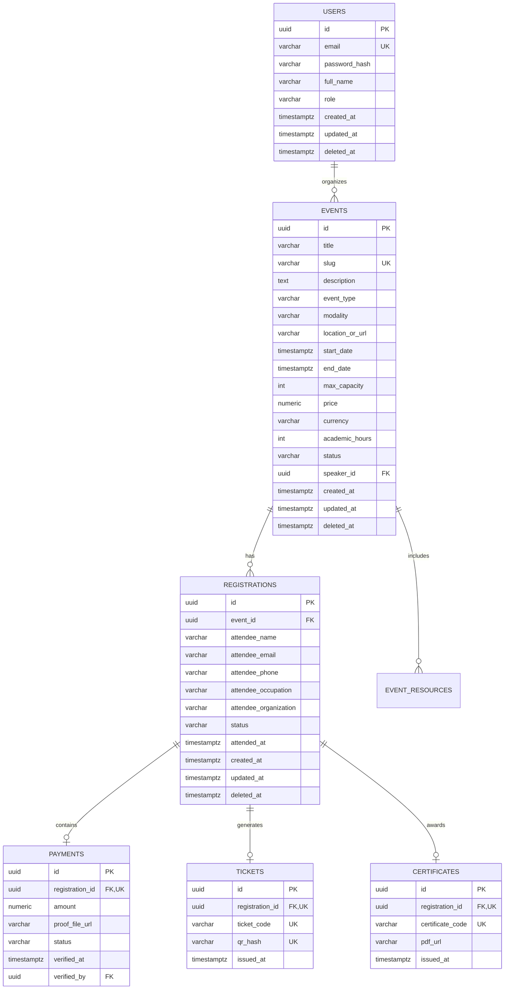

# Especificación de Requisitos de Software (SRS / SDD)
## Proyecto: Sistema de Gestión de Inscripciones, Asistencia y Certificación para Talleres y Conferencias Técnicas
**Versión:** 1.0.0  
**Autor:** Ingeniero de Sistemas / Arquitecto de Software  
**Fecha:** Noviembre 2026  
**Metodología:** Spec-Driven Development (SDD)

---

## 1. Visión General del Producto

### 1.1 Objetivo del Negocio
Desarrollar una plataforma integral orientada a profesionales y estudiantes de tecnología que permita la divulgación, inscripción, control de acceso (Check-in con QR) y certificación automatizada de talleres prácticos (hands-on) y conferencias dictadas por un Ingeniero de Sistemas.

### 1.2 Alcance del Sistema
El sistema consta de dos módulos principales:
1. **Portal Público (Asistentes):**
   - Catálogo de conferencias y talleres técnicos con filtros dinámicos (modalidad, tecnología, estado).
   - Detalle del evento: Temario granular, requisitos técnicos previos, software a instalar, cupos en tiempo real, perfil del ponente.
   - Formulario de inscripción ágil con validación de datos.
   - Emisión inmediata de Pase de Acceso (Ticket Digital) con código QR criptográficamente firmado.
   - Módulo público de Verificación de Certificados con validación de autenticidad mediante código único o QR.
2. **Panel de Control Administrativo (Organizador / Ingeniero):**
   - Dashboard de métricas: Asistentes registrados, aforo restante, tasa de asistencia, ingresos/estados de pago.
   - CRUD de Eventos: Programación de talleres/conferencias, gestión de cupos, modalidades (Presencial, Virtual, Híbrido), subida de recursos y enlaces de transmisión.
   - Control de Acreditación / Check-in: Escáner QR en tiempo real para validar el pase de los asistentes y registrar su presencia.
   - Gestión y Validación de Pagos: Revisión de comprobantes para eventos arancelados.
   - Motor de Certificación: Generación dinámica en PDF de certificados de asistencia con código QR único, firma y descarga/envío por correo.

---

## 2. Requisitos Funcionales (RF)

### Módulo 1: Catálogo y Landing de Eventos
- **RF-01: Listado de Eventos:** El sistema debe mostrar los eventos públicos clasificados en "Talleres", "Conferencias" y "Bootcamps", indicando fecha, horario, modalidad (Virtual/Presencial), tecnología principal y estado ("Inscripciones Abiertas", "Cupos Agotados", "Finalizado").
- **RF-02: Detalle del Evento:** Debe exponer el temario detallado por módulos, prerrequisitos de hardware/software, perfil del ponente, cupos disponibles en tiempo real y modalidad de acceso.
- **RF-03: Control de Aforo en Tiempo Real:** El sistema debe bloquear automáticamente nuevas inscripciones cuando el contador de cupos confirmados alcance el aforo máximo (`max_capacity`).

### Módulo 2: Inscripción y Pase Digital (Ticket QR)
- **RF-04: Formulario de Inscripción:** El participante debe registrar: Nombre completo, Correo electrónico, Teléfono/WhatsApp, Rol/Profesión (Estudiante, Desarrollador, etc.) y Empresa/Universidad.
- **RF-05: Validación de Duplicidad:** El sistema debe impedir inscripciones duplicadas para el mismo evento con el mismo correo electrónico.
- **RF-06: Gestión de Modalidad de Pago:** 
  - Si el evento es *Gratuito*, la inscripción se confirma automáticamente.
  - Si el evento es *De Pago*, el asistente podrá adjuntar su comprobante de transferencia y la inscripción queda en estado `PENDING_PAYMENT` hasta aprobación manual del administrador.
- **RF-07: Generación de Ticket Digital:** Con la inscripción confirmada, se genera un ticket digital con diseño profesional que incluye: Nombre, Evento, Fecha/Hora, Instrucciones de conexión/locación, y un código QR único firmado con token hash seguro (UUIDv4/HMAC).
- **RF-08: Descarga y Envío de Ticket:** El participante debe poder descargar su ticket en PDF o imagen, y recibir confirmación por correo electrónico.

### Módulo 3: Panel Administrativo y Métricas
- **RF-09: Autenticación de Administrador:** Acceso protegido mediante credenciales cifradas con contraseñas seguras (Argon2 / BCrypt) y sesión mediante Cookies `HttpOnly` `SameSite=Strict`.
- **RF-10: Dashboard Operativo:** Visualización de métricas en vivo: Total de eventos activos, inscritos globales, cupos ocupados vs libres, ingresos acumulados y gráfico de conversiones.
- **RF-11: Gestión de Eventos (CRUD):** Creación, edición, cancelación y cierre de talleres. Parámetros: Título, Slug amigable, Descripción rica, Fecha de inicio y fin, Modalidad, Ubicación/Enlace, Aforo, Costo (o Gratis), Requisitos técnicos y Certificación (horas académicas).
- **RF-12: Gestión de Asistentes:** Tabla interactiva con búsqueda por nombre, email o teléfono; filtros por estado (`CONFIRMED`, `PENDING_PAYMENT`, `ATTENDED`, `CANCELLED`); y acción de exportación a archivo CSV/Excel.

### Módulo 4: Acreditación y Check-in en Tiempo Real
- **RF-13: Lector de QR (Web Scanner):** El panel de administración debe contar con una interfaz de escáner QR que use la cámara del dispositivo móvil o webcam para leer los tickets de los asistentes.
- **RF-14: Validación Instantánea:** Al escanear un QR:
  - Si es válido y no ha ingresado: Marca el estado como `ATTENDED`, registra la marca temporal `attended_at` y muestra feedback visual verde con los datos del participante.
  - Si ya fue marcado previamente: Muestra alerta roja de "Ticket ya utilizado" con la hora de su primer ingreso.
  - Si no existe o corresponde a otro evento: Muestra alerta de "Ticket Inválido".
- **RF-15: Check-in Manual:** En caso de falla de cámara, el organizador debe poder buscar al participante por nombre o correo y marcar su asistencia manualmente.

### Módulo 5: Generación y Validación de Certificados
- **RF-16: Emisión Automatizada de Certificados:** Una vez concluido el evento, el administrador puede habilitar la emisión de certificados exclusivamente a los participantes que tengan estado `ATTENDED`.
- **RF-17: Plantilla de Certificado en PDF:** El certificado debe generarse en alta resolución vectorial (PDF) conteniendo:
  - Nombre del participante.
  - Título del taller o conferencia y carga horaria en horas académicas.
  - Firma digitalizada del Ingeniero de Sistemas.
  - Código único alfanumérico de certificación (ej: `CERT-2026-ENG-84920`).
  - Código QR que redirige a la URL pública de validación.
- **RF-18: Verificador Público de Certificados (`/verificar/:code`):** Cualquier tercero (empresas, reclutadores) puede ingresar a la ruta pública o escanear el QR del certificado para ver la ficha oficial de autenticidad respaldada por la base de datos.

---

## 3. Requisitos No Funcionales (RNF)

- **RNF-01: Rendimiento:** Carga inicial de página (LCP) inferior a 1.5 segundos. Respuestas de API de registro y validación inferiores a 250ms.
- **RNF-02: Seguridad (OWASP Top 10):**
  - Sanitización estricta de todos los inputs con Zod.
  - Parametrización estricta de consultas SQL para prevenir SQL Injection vía ORM (Prisma).
  - Protección contra XSS y CSRF.
  - Cabeceras de seguridad HTTP (HSTS, Content-Security-Policy, X-Frame-Options).
  - Tokens de acceso seguros e intransferibles en códigos QR.
- **RNF-03: Base de Datos y Escalabilidad:**
  - PostgreSQL 18 como motor relacional primario.
  - Esquema normalizado en Tercera Forma Normal (3NF).
  - Índices B-Tree en campos de búsqueda y claves foráneas.
  - Soporte de Soft Deletes (`deleted_at`) en tablas transaccionales.
- **RNF-04: Usabilidad y Accesibilidad (UI/UX):**
  - Diseño responsivo mobile-first optimizado para smartphones (donde los asistentes presentarán su ticket QR).
  - Estética técnica moderna: Modo oscuro predominante con acentos cyan/azul tecnológico, tipografía sans-serif legible (Inter / Geist), micro-animaciones fluidas.
  - Cumplimiento de accesibilidad WCAG AA.
- **RNF-05: Concurrencia e Integridad Transaccional:**
  - Manejo de transacciones ACID para evitar sobreventa de cupos cuando varios usuarios intenten inscribirse simultáneamente en el último asiento disponible.

---

## 4. Modelo de Datos y Esquema Relacional (PostgreSQL)

---

## 5. Plan de Ejecución Fase a Fase (SDD Roadmap)

- **Fase 1: Especificación y Configuración del Ecosistema (Actual)**
  - Configuración de Skills SDD, MCP Server de PostgreSQL y repositorio.
  - Aprobación formal del documento de especificación.
- **Fase 2: Arquitectura Base, Setup del Proyecto y Base de Datos**
  - Inicialización del proyecto Next.js (App Router, Tailwind CSS, TypeScript).
  - Modelado e inicialización de Prisma ORM conectado a PostgreSQL local (`sistema_inscripciones`).
  - Creación de migraciones iniciales y seed de datos de prueba (talleres de ejemplo, credenciales de admin).
- **Fase 3: Desarrollo del Módulo Público (Catálogo, Landing y Registro)**
  - Diseño de la interfaz pública con Tailwind CSS (Dark Tech UI).
  - Vistas de catálogo y detalle técnico de conferencias.
  - Formulario de inscripción reactivo con Zod y Server Actions transaccionales para reserva de cupos.
  - Generación de Ticket Digital con QR dinámico y vista de descarga/impresión.
- **Fase 4: Panel Administrativo, Escáner QR de Asistencia y Certificados**
  - Autenticación segura de administrador.
  - Dashboard con métricas de aforo e inscritos.
  - CRUD de eventos y exportador de asistentes a CSV.
  - Módulo de Escáner QR con cámara para control de asistencia en tiempo real.
  - Generador de Certificados en PDF y portal público de verificación (`/verificar/:code`).
- **Fase 5: Pruebas Automatizadas (QA), Validación y Despliegue**
  - Pruebas unitarias de reglas de negocio (cupos, duplicidad, firma QR).
  - Pruebas E2E del flujo completo (Inscripción -> Ticket -> Check-in -> Certificado).
  - Auditoría de seguridad y rendimiento (Lighthouse, OWASP, validación SDD).

